# openOODA Organization Icon Gallery (`brand/`)

Side-by-side comparison of three unified icon themes across all 9 organizations (`@openOODA` Root + `L0`–`L7`), shown at both **Large (`112px`)** and **GitHub Header / Switcher (`36px`)** sizes.

- **Option A (`option-a/`)**: **Dark Silicon Chassis + Layer Glyph + Layer Code (`.oo` / `L0`–`L7`)**
- **Option B (`option-b/`)**: **Pure Geometric Emblem (Zero Text, High-Contrast Symbol Only)**
- **Option C (`option-c/`)**: **Brutalist Industrial Badge (Color Header Bar + Giant Monospace Code)**

---

## Side-by-Side Comparison (`112px` & `36px` Small Preview)

| Organization | Layer & Color | Option A (Glyph + `L0`–`L7`) | Option B (Pure Geometric) | Option C (Brutalist Badge) |
| :--- | :--- | :---: | :---: | :---: |
| **`@openOODA`** | **Root** (`#00E676` Emerald) |   | 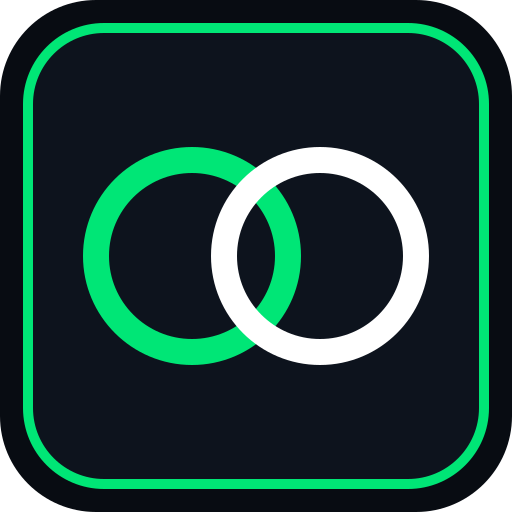  |   |
| **`@openOODA-core`** | **`L0`** (`#00E5FF` Cyan) |   | 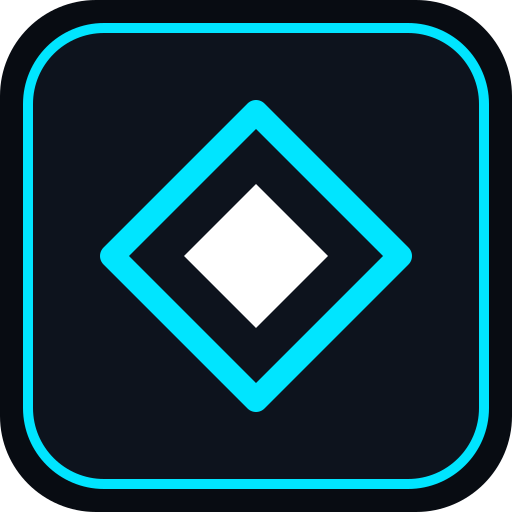  | 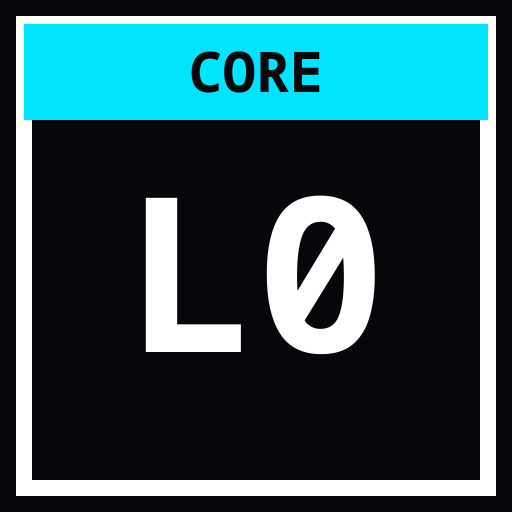  |
| **`@openOODA-kernel`** | **`L1`** (`#FF3366` Crimson) | 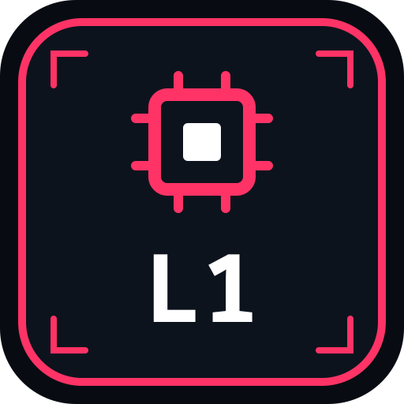  | 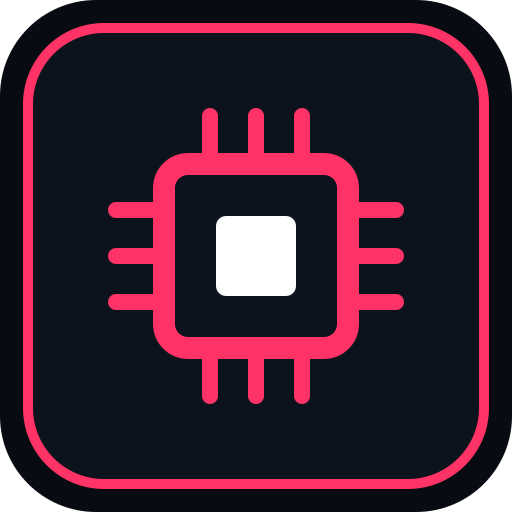  | 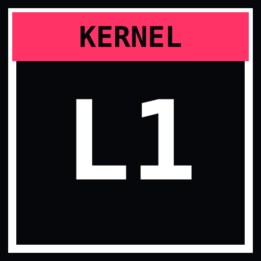  |
| **`@openOODA-OS`** | **`L2`** (`#FFB300` Amber) | 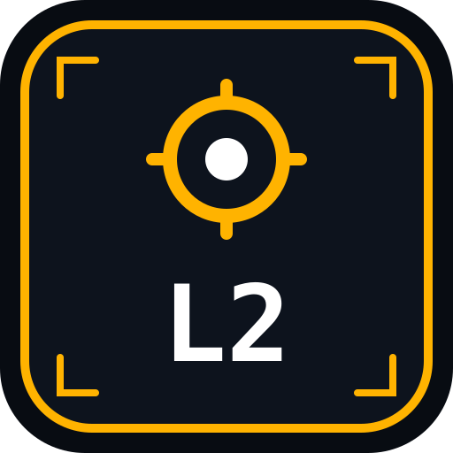  |   | 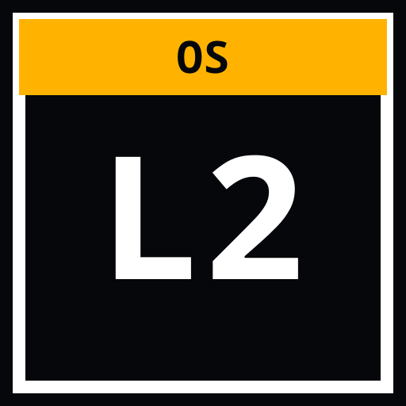  |
| **`@openOODA-tools`** | **`L3`** (`#76FF03` Lime) |   |   | 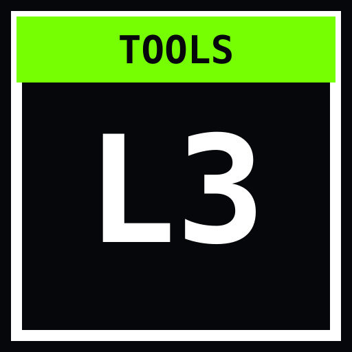  |
| **`@openOODA-DE`** | **`L4`** (`#2979FF` Electric Blue) |   | 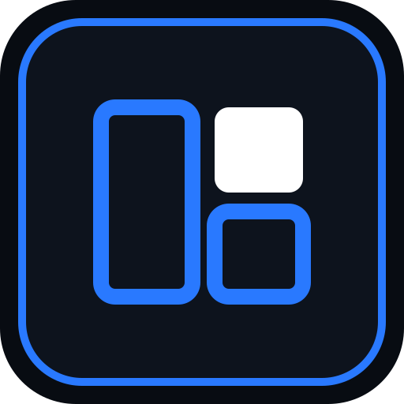  | 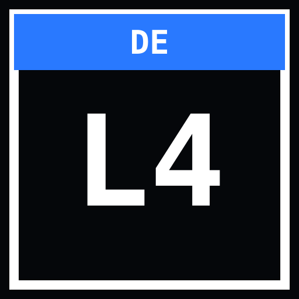  |
| **`@openOODA-apps`** | **`L5`** (`#D500F9` Violet) | 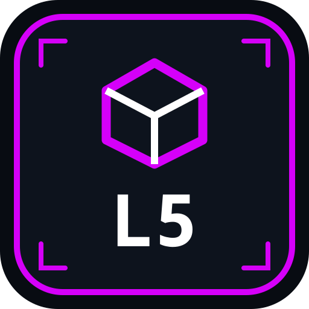  | 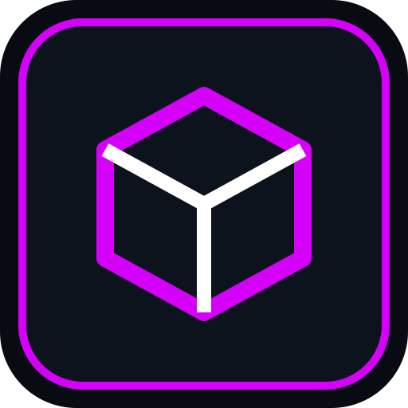  | 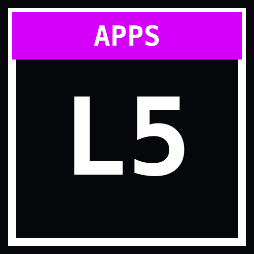  |
| **`@openOODA-cloud`** | **`L6`** (`#1DE9B6` Teal) |   | 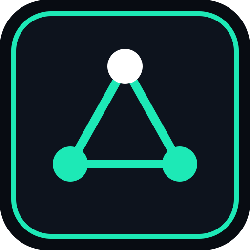  | 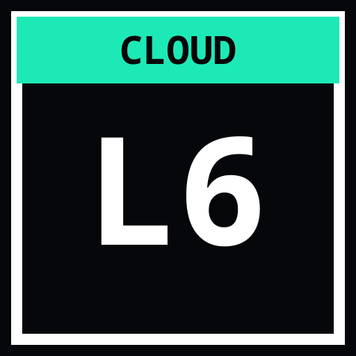  |
| **`@openOODA-agents`** | **`L7`** (`#FFD600` Gold) | 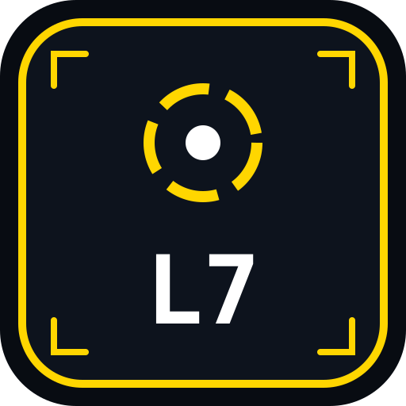  | 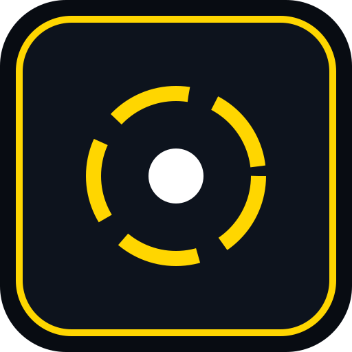  |   |
