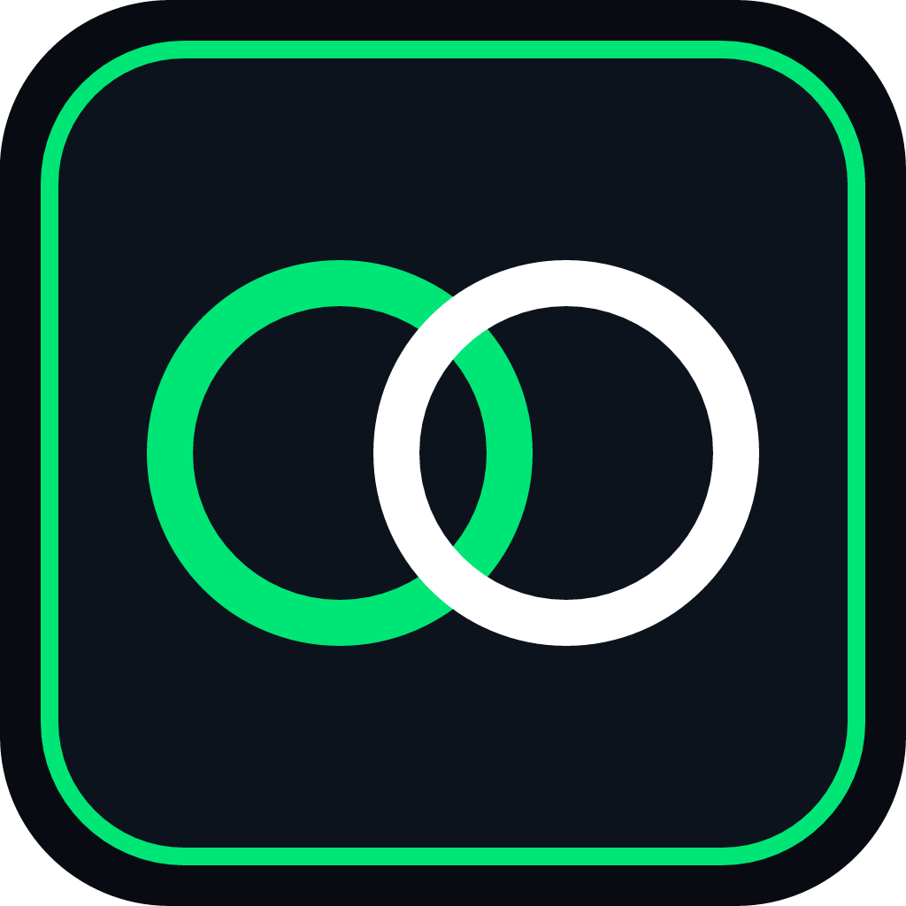
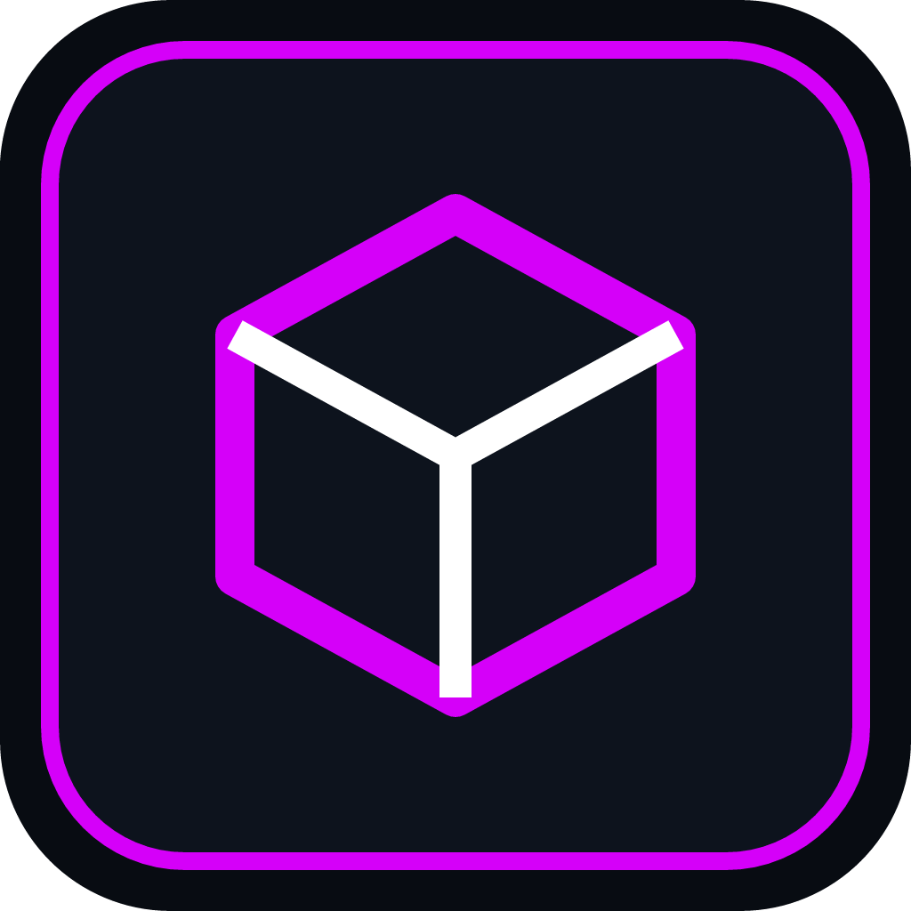

#  openOODA

Capability-secured computing stack built in native `.oo` with zero ambient authority and single-cycle 64-bit hardware/software capabilities (`CapReg64`).

- **Website**: [https://openooda.org](https://openooda.org)
- **Binary & ISO Release Hub**: [`openOODA/install@hub`](https://github.com/openOODA/install/releases/tag/hub)
- **Package Registry**: [`openOODA/catalog`](https://github.com/openOODA/catalog)
- **Brand & Icon Gallery**: [`openOODA/.github/brand`](https://github.com/openOODA/.github/tree/master/brand)

## Quick Install

```sh
curl -fsSL https://openooda.org/install.sh | bash
```

Manage layers and packages with `ooda-package`:

```sh
ooda-package install ooda-standard  # standard library + solver
ooda-package install ooda-compiler  # native .oo compiler
ooda-package install ooda-verify    # 8-hat verifier (quorum_mask=255)
```

## Root Repositories (`@openOODA`)

| Repository | Role |
| :--- | :--- |
| [`openOODA`](https://github.com/openOODA/openOODA) | Governance charter (`AGENTS.md`) and the 8 Quick Cards (`cards/`) |
| [`install`](https://github.com/openOODA/install) | Universal bootstrap installer, bootable Live ISO (`ooda-os-x86_64.iso`), Buildbox, and binary release hub |
| [`catalog`](https://github.com/openOODA/catalog) | Signed 4-org package registry queried by `ooda-package` |
| [`website`](https://github.com/openOODA/website) | Static source for [https://openooda.org](https://openooda.org) (`docs/`) |
| [`.github`](https://github.com/openOODA/.github) | Organization profile, brand icon gallery (`brand/`), and GitHub Linguist grammar (`linguist/`) |

## 4-Organization Ecosystem

| Icon | Organization | Repos | Packages | Scope |
| :---: | :--- | :---: | :---: | :--- |
|  | [`@openOODA`](https://github.com/openOODA) | `5` | `4` | Governance & Quick Cards (`openOODA`), Binary & ISO Hub (`install`), Package Catalog (`catalog`), Website (`website`), Org Profile (`.github`) |
|  | [`@openOODA-core`](https://github.com/openOODA-core) | `16` | `15` | `ooda`, `ooda-binary`, `ooda-bridge`, `ooda-build`, `ooda-compiler`, `ooda-engine`, `ooda-format`, `ooda-interface`, `ooda-language`, `ooda-package`, `ooda-provenance`, `ooda-runtime`, `ooda-sign`, `ooda-standard`, `ooda-verify`, `.github` |
|  | [`@openOODA-system`](https://github.com/openOODA-system) | `38` | `37` | Base (`ooda-archive`, `ooda-boot`, `ooda-container`, `ooda-data`, `ooda-drivers`, `ooda-files`, `ooda-hardware`, `ooda-health`, `ooda-kernel`, `ooda-machine`), Services (`ooda-authority`, `ooda-bus`, `ooda-connect`, `ooda-database`, `ooda-firewall`, `ooda-inference`, `ooda-modem`, `ooda-network`, `ooda-sandbox`, `ooda-shell`, `ooda-vault`), Shell & Tools (`ooda-compositor`, `ooda-disk`, `ooda-edit`, `ooda-filesystem`, `ooda-list`, `ooda-panel`, `ooda-portal`, `ooda-read`, `ooda-screensaver`, `ooda-settings`, `ooda-start`, `ooda-terminal`, `ooda-text`, `ooda-theme`, `ooda-version`, `ooda-web`), `.github` |
|  | [`@openOODA-apps`](https://github.com/openOODA-apps) | `19` | `18` | `ooda-arcade`, `ooda-audio`, `ooda-browser`, `ooda-calculator`, `ooda-camera`, `ooda-canvas`, `ooda-chat`, `ooda-commander`, `ooda-emulator`, `ooda-flasher`, `ooda-office`, `ooda-passwords`, `ooda-player`, `ooda-remote`, `ooda-store`, `ooda-strike`, `ooda-studio`, `ooda-voxel`, `.github` |

**Fleet Census**: `70` product packages (`15` core + `37` system + `18` apps) + `4` `@openOODA` umbrella repos = `74` product+platform repos + `4` `.github` org-profile repos = `78` total repos across the 4 canonical organizations.

`ooda-standard` ships the expanded scientific & mathematical discovery library: `ooda-standard/core/math/{exact,geometry,blas,fft,algebra,graph_topology}/...`, `ooda-standard/core/proofs/...`, `ooda-standard/core/science/{phys,chem,bio,comm,econ}/...`, frontier AI-for-science `ooda-standard/core/app/ai/...`, 2D/3D engine physics `ooda-standard/core/app/ui/game_engine/...` (`collision_{aabb,circle,gjk,sat}` + `ecs_*`), `ooda-standard/core/collection/...`, and `ooda-standard/sec/{hash,capability,pqc,symmetric}/...`.

Canonical members (one per organization for conformance): `openOODA` (`@openOODA` umbrella), `ooda-compiler` (`@openOODA-core` toolchain), `ooda-shell` (`@openOODA-system` shell), `ooda-browser` (`@openOODA-apps` browser).

## System Requirements

| Tier | Target Workload | CPU & Vector / TEE Extensions | Memory (RAM & CXL) | Storage & Bus | Host OS / Firmware / Interconnect |
| :--- | :--- | :--- | :--- | :--- | :--- |
| **Tier 1: CLI / TUI & Tools** | Pre-built `@openOODA-system` CLI suites, `ooda-screensaver`, `ooda-flasher` | `x86_64` (AVX2/AVX-512), `ARM64` (`SVE2`), or `RISC-V` (`RVV 1.0`) (1+ core) | **64 – 256 MiB** (`2–24 MiB` RSS per tool) | **10 – 250 MiB** (`~0.3–3 MiB` per static binary) | Linux `4.19+` (`5.15+` for `io_uring`/Landlock), openOODA OS, Windows 10/11 (`PE32+`), macOS, WASM32 |
| **Tier 2: Bare-Metal OS & Desktop** | `ooda-boot` + `ooda-kernel` + `ooda-compositor` (`ooda-terminal`, `ooda-browser`, 128 Hz engines) | 2+ cores (`4+` rec; Intel RDT / ARM MPAM L3 QoS) | **512 MiB** min (TUI) / **2 – 4 GiB** rec (Wayland desktop & 3D apps) | **1 – 4 GiB** NVMe (ZNS), SATA/AHCI, VirtIO-Blk, SDHCI/eMMC/UFS, or USB4 | UEFI (`x86_64`/`AA64`) + TPM 2.0 / DICE / Caliptra Root-of-Trust, GOP/DRM-KMS/VirtIO-GPU 3D |
| **Tier 3: Developer Workstation** | Building from source with `ooda-compiler`, SMT/Z3 proofs & 8-hat `ooda-verify` verification | 4+ cores / 8+ threads (`16+` threads; AMD SEV-SNP / Intel TDX / ARM CCA TEE) | **8 – 16 GiB** min (`3` compiler slots) / **32 – 64 GiB+** rec (`8` slots) | **20 – 50 GiB** NVMe SSD (78 repos + `.ooda-cache`) | Linux `x86_64` / `ARM64` or openOODA Buildbox container (SR-IOV VF / VirtIO-FS DAX) |
| **Tier 4: AI & Frontier Science** | Local `ooda-inference` agent swarm (`ooda-chat`, `ooda-studio` AI helpers) & `ooda-standard` GPU/NPU compute kernels | Multi-core CPU (Intel AMX / ARM SME) + NVIDIA (`CUDA` SM 7.5+) or AMD (`ROCm`) | **16 GiB+** system RAM / **CXL 3.0** pool + **8 – 24 GiB+ VRAM** per GPU | **50 GiB+** NVMe / Peer-to-Peer DMA (`peer_dma`) | Zero-Copy **RDMA / RoCEv2 / InfiniBand** fabric + CUDA, ROCm, or Vulkan (automatic CPU fallback) |
